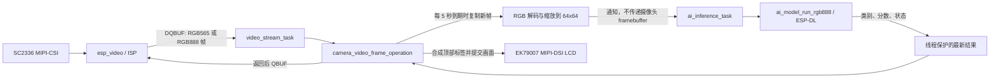

# Mango AI：ESP32-P4 芒果成熟度演示

本项目在 ESP32-P4 上运行量化 CNN，对摄像头画面进行整图三分类，并通过 MIPI-DSI LCD 持续显示预览和最新分类状态。摄像头使用 SC2336，屏幕使用 EK79007 面板；端侧推理由 Espressif [esp-dl](https://github.com/espressif/esp-dl) 执行。

当前类别顺序固定为：`0=半成熟`、`1=成熟`、`2=未成熟`。这是整幅图像分类，不会定位芒果或绘制检测框。

## 当前功能

- SC2336 MIPI-CSI 摄像头预览，默认 1024×600、RAW8 传感器模式、约 30 FPS。
- 7 英寸 1024×600 MIPI-DSI LCD 实时显示；尺寸不匹配时使用 PPA 做画面处理。
- 摄像头流启动后立即对一帧推理，之后约每 5 秒取一张新帧推理一次，不逐帧运行 AI。
- LCD 顶部显示 ASCII 状态，例如 `AI MATURITY: UNRIPE`、`AI: UPDATED`；串口输出中文类别、三个原始分数和预测类别。
- AI 推理运行在单独的 FreeRTOS task；推理输入是回调中从当前帧复制、缩放出的 64×64 RGB 数据。
- 推理失败会输出错误并将状态置为 `FAILED`；UI 保留最近一次成功类别。

模型推理成功日志只能证明模型执行并返回有效分数，不等于识别准确率已验证。三个串口分数是量化输出反量化后的模型分数，不是百分比置信度。

## 系统结构



帧流与职责：

1. `app_main()` 初始化 LCD/PPA 和 `esp_video`，打开视频设备并配置两到三块帧缓冲，然后创建 AI worker 和视频流 task。
2. `app_video.c` 中的 `video_stream_task()` 通过 `VIDIOC_DQBUF` 获取一帧，调用 `camera_video_frame_operation()`；回调返回后通过 `VIDIOC_QBUF` 将帧归还摄像头。
3. `main.c` 的回调每帧检查推理间隔。到期时，先将当前帧转换到独立的 `ai_rgb_input`，再通知 AI worker；worker 不保留摄像头帧指针。
4. 同一视频回调合成 LCD 顶部状态条并调用现有 `esp_lcd_panel_draw_bitmap()`。AI worker 只更新受临界区保护的预测结果，不直接绘制 LCD。

默认 `sdkconfig` 使用 RGB565。对于 SC2336 RAW8 配置，工程将 LCD framebuffers 作为 camera user buffers 传给视频驱动；其他分配模式可能使用独立的 camera buffers。由于 camera/LCD 在默认路径存在 framebuffer 复用，若后续出现画面撕裂、OSD 被覆盖或偶发错帧，应优先检查帧缓冲所有权与 VSYNC/帧完成交接，不要让摄像头和 LCD 同时写同一缓冲区。

## 模型与预处理

部署文件为 `models/mango_cnn.espdl`，由 `main/CMakeLists.txt` 作为对齐二进制资源嵌入固件，符号名为 `mango_cnn_espdl`。当前模型元信息和板端接口为：

| 项目 | 当前约定 |
| --- | --- |
| 模型结构 | Conv(3×3, 16) → Pool → Conv(3×3, 32) → Pool → Conv(3×3, 64) → Pool → FC(4096→128) → FC(128→3) |
| ESP-DL 输入 | `1×64×64×3`，NHWC，INT8，当前 exponent 为 `-7` |
| 训练/ONNX 输入 | PyTorch/ONNX 使用 NCHW：`1×3×64×64` |
| 摄像头格式 | 默认 RGB565；可配置 RGB888 |
| 预处理 | 拆出 RGB 通道，缩放为 64×64，映射至 `[0,1]` 后按模型 exponent 量化 |
| 输出 | `1×3`；索引按半成熟、成熟、未成熟解释 |

ONNX 导出接口采用 NCHW，而当前 `.espdl` 的运行时输入是 NHWC；替换模型时必须以新 `.espdl` 的元信息为准，并同步更新固件形状、通道布局、类别数量及映射。训练和 PC 推理使用 `Resize((64,64))` 与 `ToTensor()`；固件使用双线性采样，但当前实现没有完全复刻 PIL 下采样抗锯齿，因此两端输入可能略有差异。

`ai_model.cpp` 中 `dl::Model` 由静态指针延迟创建，后续推理复用同一对象。模型对象持有可变输入/输出和执行上下文，当前由单个 worker 串行使用；不要从多个 task 并发调用同一实例。网络层 `model->print()` 目前每次推理都会打印，可在后续调试优化中改为只打印一次。

## 目录说明

```text
mango_ai_p4/                 ESP-IDF 固件工程
├── main/
│   ├── main.c                应用初始化、取帧回调、5 秒调度、预处理、OSD
│   ├── app_video.c/.h        esp_video/V4L2 风格取帧与 buffer 管理
│   ├── app_lcd.c/.h          EK79007 MIPI-DSI LCD 初始化
│   ├── ai_model.cpp/.h       ESP-DL 模型加载、量化输入、推理与分类结果
│   ├── Kconfig.projbuild     Mango AI menuconfig 项
│   └── idf_component.yml     ESP-IDF 组件依赖
├── models/
│   ├── mango_cnn.pth         PyTorch checkpoint
│   ├── mango_cnn.onnx        导出的 ONNX 图
│   ├── mango_cnn.onnx.data   ONNX 权重数据
│   ├── mango_cnn.json        PPQ 量化配置
│   ├── mango_cnn.info        ESP-DL 模型结构/张量信息
│   └── mango_cnn.espdl       固件嵌入的量化模型
├── partitions.csv            含 15 MiB factory app 分区
├── sdkconfig.defaults        ESP32-P4、SC2336、PSRAM 等默认配置
└── CMakeLists.txt
```

PC 训练工程和数据集位于独立的同级目录 `../mangoAI/`，不包含在本固件仓库中。该目录目前提供 `split_dataset.py`、`train_cnn.py`、`evaluate.py`、`predict.py`、`export_onnx.py` 和 `quantize_espdl.py`。

## 硬件与环境

- ESP32-P4 开发板；当前配置使用 16 MiB Flash 和 200 MHz PSRAM。
- SC2336 MIPI-CSI 摄像头。
- EK79007 驱动的 1024×600 MIPI-DSI LCD。
- USB 数据线用于供电、烧录和串口监视。
- ESP-IDF：当前工程已在 v5.5.5 环境构建；组件清单声明 IDF `>=5.3`。请使用支持 ESP32-P4 的 ESP-IDF 工具链。

屏幕转接板额外连线：

| 转接板信号 | ESP32-P4 Function EV Board |
| --- | --- |
| 5V | 5V |
| GND | GND |
| PWM | GPIO26 |
| LCD_RST | GPIO27 |

MIPI-CSI 和 MIPI-DSI 使用对应板卡接口连接；请确认屏幕、摄像头供电和排线方向符合硬件板说明。

当前 `sdkconfig.defaults` 中 SCCB 为 SCL GPIO8、SDA GPIO7，摄像头选项为 SC2336 RAW8 1024×600@30fps。实际生效配置以本机 `sdkconfig` 为准。

## 编译、烧录与运行

在 ESP-IDF 命令环境中，从固件工程根目录执行：

```powershell
idf.py set-target esp32p4
idf.py build
idf.py -p COM5 flash monitor
```

首次配置目标芯片时执行 `set-target`；后续通常只需 build 和 flash。将 `COM5` 替换为实际串口。

正常启动时可关注以下日志：

- `Detected Camera sensor PID`：摄像头识别成功。
- `Video Stream Start`：视频流启动。
- `Captured fresh ... camera frame for AI`：当前新帧进入低频 AI 流程，约每 5 秒一次。
- `Starting inference with camera RGB input`、三类分数、`Inference succeeded...` 与 `Prediction: ...`：ESP-DL 推理及输出检查完成。
- `fps: ...`：默认每 50 帧统计一次预览帧率。

屏幕 OSD 当前为 ASCII 英文标签。串口输出中文类别。若仅看到摄像头预览但没有 AI 日志，检查 AI task 创建、摄像头回调和推理错误日志；若串口推理成功但屏幕没有标签，检查当前显示缓冲区配置及帧缓冲交接。

## 配置入口

运行 `idf.py menuconfig`：

- `Mango AI Configuration`：SCCB 引脚/频率、FPS 日志、camera buffer 数量、RGB565/RGB888、水平/垂直翻转、memory mapping。
- `Component config → Espressif Camera Sensors`：选择 SC2336 及 RAW8 1024×600@30fps MIPI 模式。

改动 RGB 格式时，检查 `APP_VIDEO_FMT`、AI 像素解码、OSD 写入格式和 LCD pixel format 是否一致。

## 训练与模型更新

以下命令在独立的 `../mangoAI/` 目录执行。数据目录预期为：

```text
dataset/
├── raw/
│   ├── 未成熟/
│   ├── 半成熟/
│   └── 成熟/
└── calib/                 # 量化校准图片
```

基础流程：

```powershell
cd ..\mangoAI
python split_dataset.py
python train_cnn.py
python evaluate.py
python export_onnx.py
python quantize_espdl.py
```

训练代码用 `ImageFolder` 自动按目录名排序并保存 `classes` 和 `class_to_idx`；`split_dataset.py` 中单独打印的映射不决定训练标签。当前工程目录没有 `mango_cnn.pth` checkpoint，因此更新模型前要查看 `train_cnn.py` 打印的实际映射，并确认索引 0/1/2 与固件 `CLASS_NAMES` 的“半成熟/成熟/未成熟”一致。量化脚本使用校准集，将 RGB 图片 resize 到 64×64、除以 255 并转换为 NCHW 输入。更新权重后，还要核对 ONNX 输入、`.espdl` 实际输入、输出数量及固件预处理。

量化完成后，可从 PC 工程把部署模型复制到固件工程，再重新构建：

```powershell
Copy-Item .\models\mango_cnn.espdl ..\mango_ai_p4\models\mango_cnn.espdl
cd ..\mango_ai_p4
idf.py build
```

不要仅凭训练集准确率或一张图片的预测判断模型效果。建议保留按芒果个体隔离的独立测试集，报告混淆矩阵及每类召回率；同一颗芒果的近似照片若跨越训练集和测试集，指标可能虚高。设备端当前打印的是模型分数，不是已校准的置信概率。

## 后续优化方向

建议按以下顺序推进：

1. **数据与评估**：扩充不同果实、光照、背景和拍摄距离的样本；按果实个体拆分数据，增加混淆矩阵和每类召回率。
2. **预处理一致性**：验证 RGB565/RGB888 通道顺序、色彩范围及固件缩放与 PIL resize 的差异；必要时实现一致的抗锯齿下采样并用同一图片对比 PC 与板端分数。
3. **帧缓冲所有权**：明确摄像头写入和 LCD 扫描期间的 buffer 状态，采用可验证的帧完成/VSYNC 交接，避免共享 framebuffer 被同时访问。
4. **显示体验**：为中文 OSD 引入适合的字库，显示最近更新时间或运行耗时；确认不会因文字合成影响预览帧率。
5. **推理可观测性**：给每次推理增加序号和耗时；只在首次加载时打印网络结构；记录失败原因而不把原始 logits 显示为概率。
6. **模型效率与泛化**：在准确率和端侧 RAM/PSRAM、Flash、延迟约束下比较轻量结构和量化方案；每次替换模型都重新做独立测试集与实机验证。

模型更新通常不只是“换权重”：若类别顺序、输入形状、通道布局、归一化、量化 exponent 或输出结构改变，固件接口与预处理也必须同步修改。当前项目能证明端侧推理链路可运行；成熟度识别准确率和不同光照下的稳定性仍需用实物测试集验证。

## 参考

- 视频/LCD 基础参考：[ESP-IDF MIPI DSI LCD 示例](https://github.com/espressif/esp-idf/tree/master/examples/peripherals/lcd/mipi_dsi)
- 推理框架：[ESP-DL](https://github.com/espressif/esp-dl)
- 摄像头组件：[esp_video](https://github.com/espressif/esp-video-components)
